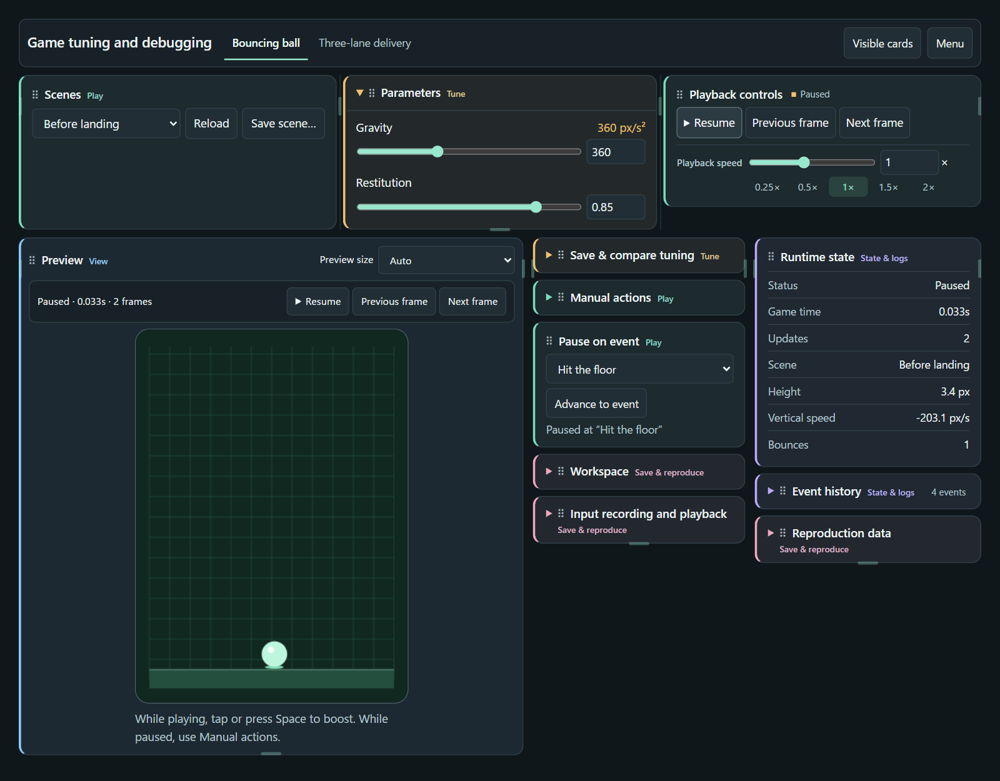
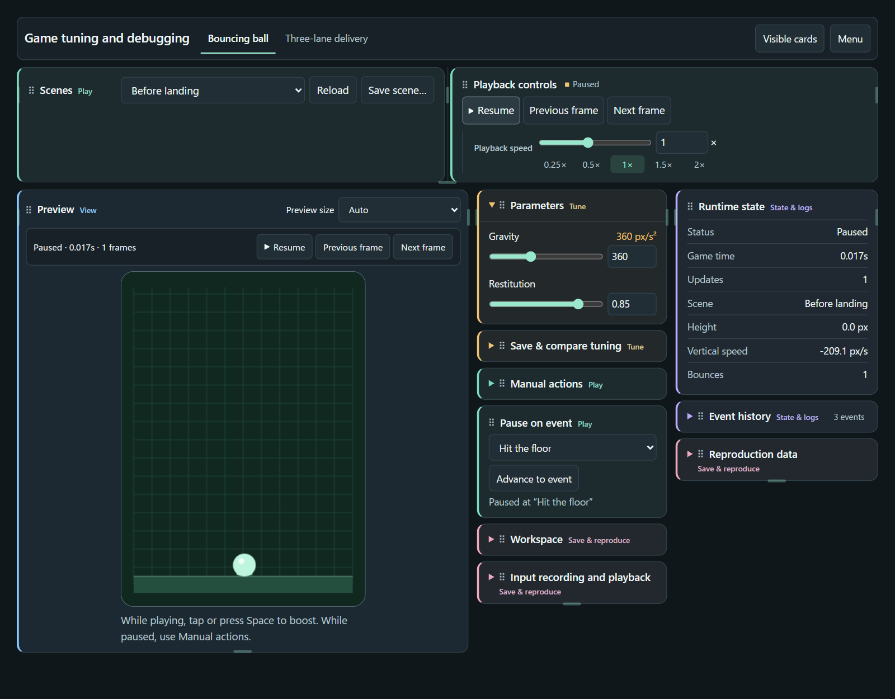
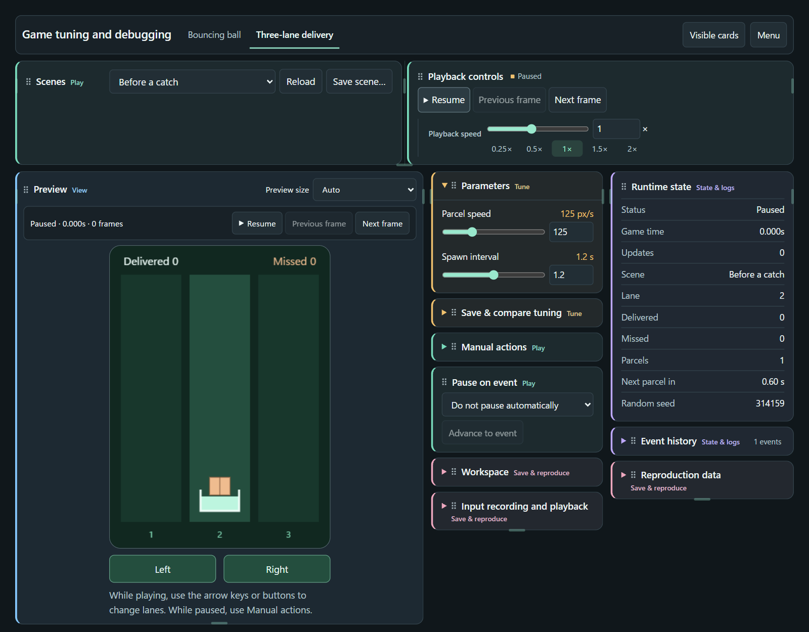

# Game Debug Workbench

A Codex and Claude Code skill for adding a debug panel to a browser game. Stop on a landing or a dialogue cue, tune values beside the live preview, and step through the moment one frame at a time.

**[Try the bouncing ball](https://roburon.github.io/game-debug-workbench/assets/web/demo.html)** · [Try three-lane delivery](https://roburon.github.io/game-debug-workbench/assets/web/lane-demo.html) · [日本語 README](README.md)



## Inspect the first frame of a rebound

1. Open the ball demo, choose **Before landing**, and enter `0.85` for **Restitution** in the Parameters card.
2. Under **Pause on event**, select **Hit the floor** and click **Advance to event**. At impact, Runtime state shows a height of `0.0 px`.
3. Click **Next frame** in the preview. The ball rises to `3.4 px`. Drag the Parameters heading into the top row to get the layout shown above. The game stays on the same frame.

<details>
<summary>See the moment of impact and the delivery game</summary>



The delivery game connects the same panel to a different set of controls.



</details>

## Shape the panel around the job

| Task | How it works |
| --- | --- |
| Arrange the controls | Drag a card heading to the side of another card to share a row, or above or below it to start a row. Drag a boundary to resize a column. Hide cards you don't use. |
| Return to a tuning session | Adjust a slider or enter an exact value. Save the scene, tuning values, card layout, and preview size as a named workspace. |
| Share a reproducible moment | Copy reproduction data and paste it into another instance of the same game. The panel validates the game and save version before restoring supported state. |
| Compare two sets of values | Record an input sequence and replay it at the same game frames from the same starting state and random conditions. Compare the outcome under settings A and B. |

## Install

Choose the command for your coding agent.

**Codex**

```sh
git clone https://github.com/roburon/game-debug-workbench.git "$HOME/.agents/skills/game-debug-workbench"
```

**Claude Code**

```sh
git clone https://github.com/roburon/game-debug-workbench.git "$HOME/.claude/skills/game-debug-workbench"
```

Start a new session in your game project and describe what you want to inspect. For example:

> Use game-debug-workbench to add a development-only panel to my platformer. Pause when the player lands and put gravity and jump strength next to the preview.

To update a Git installation, check `git status` in the skill folder, then run `git pull --ff-only`. To try the demo locally, open `assets/web/demo.html` in a browser.

## Connect your game

Start with a preview element and a function that reads the state you want to inspect. Connect your game's update loop for frame stepping, and notify the panel when a registered event occurs for automatic pauses. Restoring a shared scene requires state capture, validation, and restore. Repeatable input comparisons also need restorable randomness and an input handler that runs on the recorded game frame. Both demos use the same workbench JavaScript and CSS. [Integration guide (Japanese, with code examples)](references/integration.md) · [Ball adapter](assets/web/demo.js) · [Delivery adapter](assets/web/lane-demo.js)

The controls and demos follow the browser's preferred language (English or Japanese). Pass your game's own language setting to `mountWorkbench({ locale, ... })` to use it instead. Supply translations for game-specific labels in the adapter. [Language setup](references/integration.md#display-language)

## License

MIT. Include the copyright and permission notices when redistributing copies or substantial portions. [Full license](LICENSE)
