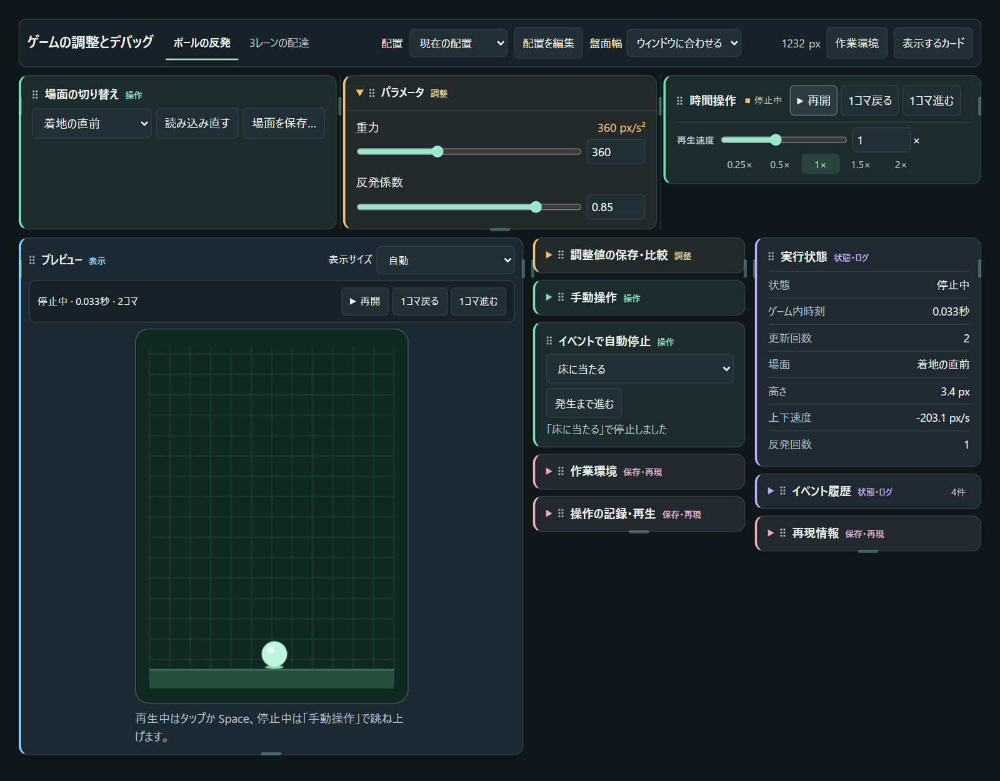
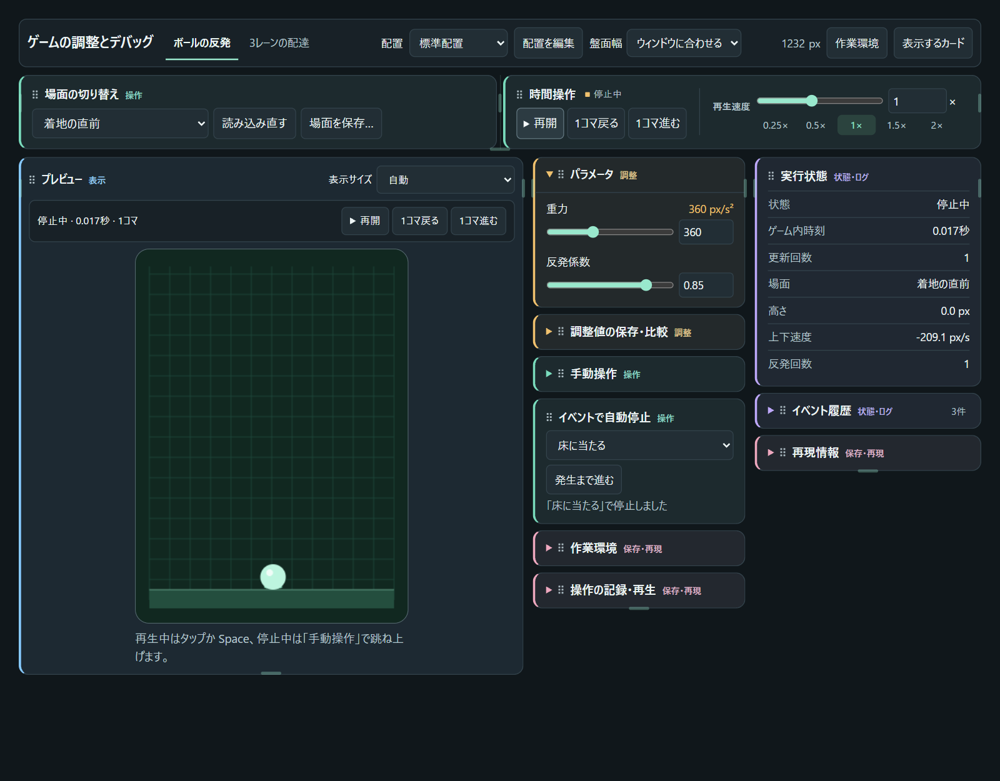
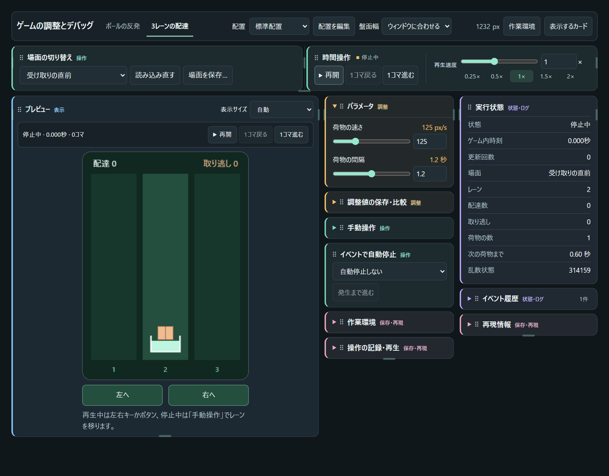

# Game Debug Workbench

ブラウザゲームに開発用のデバッグ盤を組み込む、Codex・Claude Code向けのスキルです。着地や吹き出しの表示でゲームを止め、プレビューの横で数値を変えながら、気になる動きを1コマずつ確かめられます。

**[ボールの反発を試す](https://roburon.github.io/game-debug-workbench/assets/web/demo.html)** · [3レーンの配達を試す](https://roburon.github.io/game-debug-workbench/assets/web/lane-demo.html) · [English README](README.en.md)



## 見本を試す

1. ボールの見本で「着地の直前」を選び、「パラメータ」の反発係数に `0.85` を入力します。
2. 「イベントで自動停止」で「床に当たる」を選び、「発生まで進む」を押します。床に触れた瞬間、右列の「高さ」は `0.0 px` です。
3. プレビューの「1コマ進む」を1回押すと、高さが `3.4 px` になります。「パラメータ」の見出しをつかんで上段に移すと、そのコマを保ったまま上の画像の配置を試せます。

<details>
<summary>着地で停止した画面と、配達ゲームの画面を見る</summary>



配達ゲームでは、同じ盤面で「荷物の速さ」と「荷物の間隔」を調整できます。



</details>

## 自分の作業に合わせる

| やりたいこと | 盤面でできること |
| --- | --- |
| 操作しやすい配置にする | カードの見出しを別のカードの左右に置くと横並び、上下に置くと別の行になります。境目を引いて列幅を調整し、使わないカードは隠せます。 |
| 同じ条件で調整を続ける | スライダーや数値欄で値を変え、場面・調整値・カード配置・プレビューサイズを「作業環境」にまとめて保存。次回は名前を選ぶだけで呼び出せます。 |
| 不具合が起きた場面を渡す | 再現情報をコピーし、別の環境に貼り付けて復元できます。別作品のデータや互換性のない版は、状態を変える前に理由を表示します。 |
| 同じ操作でA/Bを比べる | タップなどの入力を記録し、同じ開始状態・乱数条件から同じコマで再生します。操作のばらつきを抑えて調整値の違いを比較できます。 |

## スキルを入れる

使うツールに合わせて、どちらかを実行してください。

**Codex**

```sh
git clone https://github.com/roburon/game-debug-workbench.git "$HOME/.agents/skills/game-debug-workbench"
```

**Claude Code**

```sh
git clone https://github.com/roburon/game-debug-workbench.git "$HOME/.claude/skills/game-debug-workbench"
```

ゲームのプロジェクトで新しいセッションを開き、調べたい場面と変えたい値を伝えます。

> game-debug-workbench を使って、ゲームに開発用のデバッグ盤を追加して。着地した瞬間で止めて、重力とジャンプ力をプレビューの横で調整したい。

すでにGitで導入している場合は、スキルのフォルダで `git status` を確認し、`git pull --ff-only` で更新できます。手元で見本を試すときは `assets/web/demo.html` をブラウザで開いてください。

## 自分のゲームに組み込む

最小構成はプレビュー要素と状態を読み取る関数です。コマ送りには既存の更新ループ、自動停止にはゲーム側からのイベント通知をつなぎます。再現情報の復元には状態の保存・検証・読み込み、入力のA/B比較には乱数状態の復元と決めたコマで入力を適用する処理も必要です。2つの見本は同じJavaScriptとCSSを使い、ゲーム側の接続だけが異なります。[最小構成と機能別の組み込み手順](references/integration.md) · [ボールの実装](assets/web/demo.js) · [配達ゲームの実装](assets/web/lane-demo.js)

共通の操作と見本はブラウザの優先言語に合わせて日本語・英語で表示されます。ゲームに言語設定がある場合は `mountWorkbench({ locale, ... })` に渡し、作品固有の場面名や調整項目にはゲーム側で翻訳を用意します。[表示言語の設定](references/integration.md#display-language)

## 利用条件

MITライセンスで公開しています。商用利用・改変・再配布ができます。ソフトウェアのコピーや主要な部分を配布するときは著作権表示と許諾文を同梱してください。[ライセンス全文](LICENSE)
